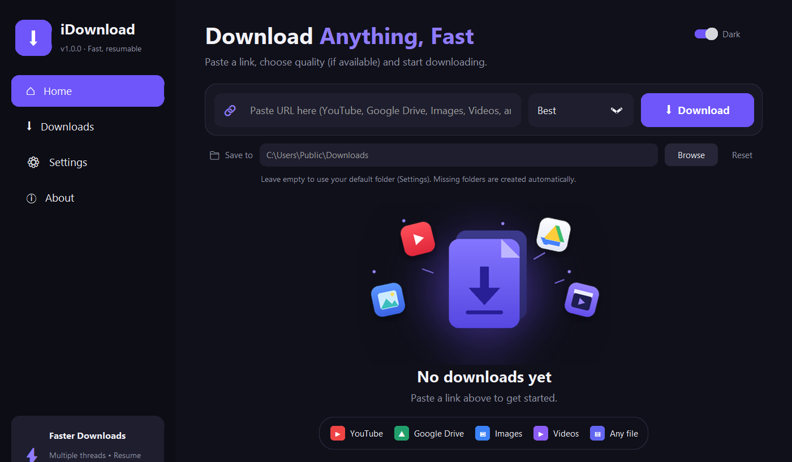
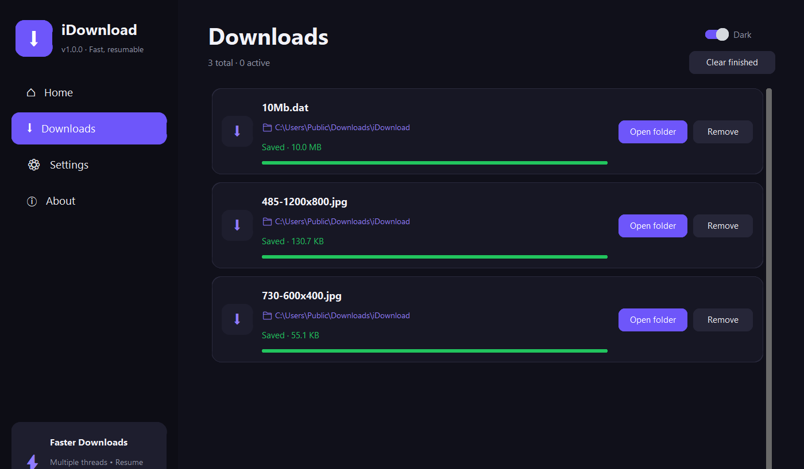
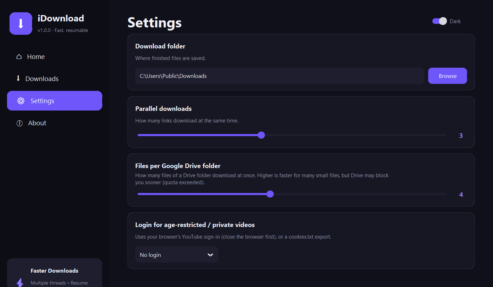
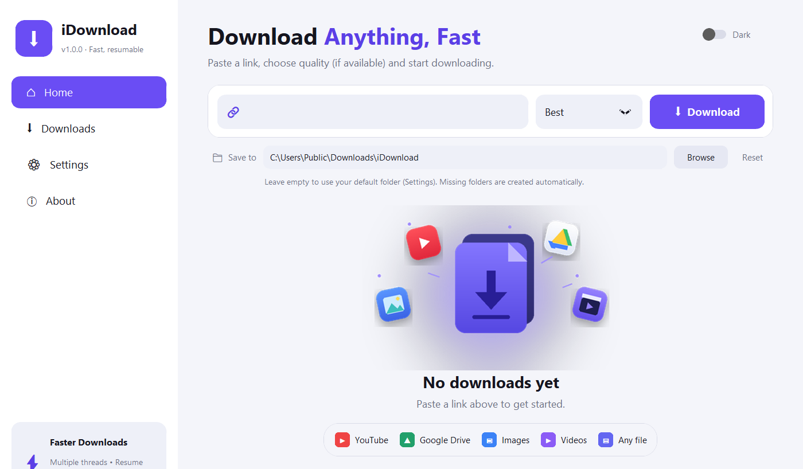
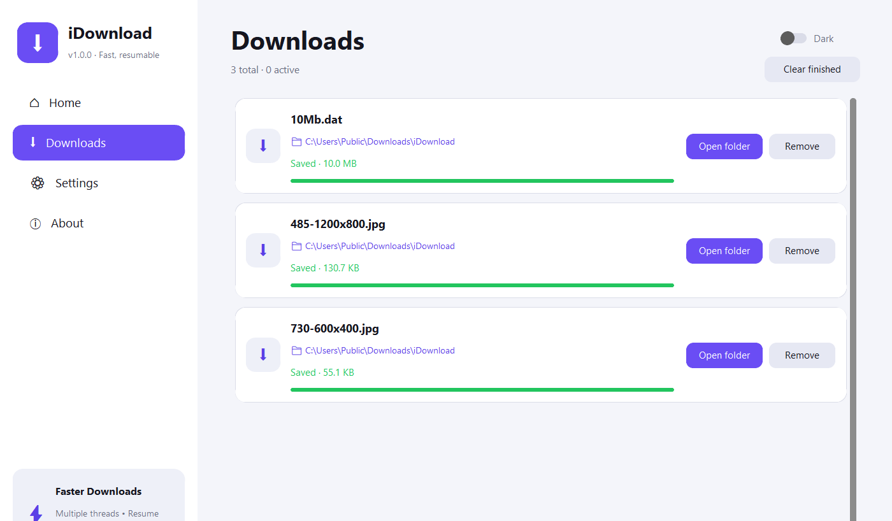

# iDownload

A fast, reliable Windows desktop downloader for **YouTube and 1,800+ video sites**, **Google Drive files and folders**, and **any image or file link**.



<details>
<summary>More screenshots</summary>

| Downloads | Settings |
|---|---|
|  |  |

| Light theme: Home | Light theme: Downloads |
|---|---|
|  |  |

</details>

## Features

- **One box for everything.** Paste a link and iDownload picks the right engine automatically.
- **Fast.** Direct files use 8 parallel connections; videos fetch 8 fragments at once; Drive folders download several files at once.
- **Reliable.** Automatic retries, resume of interrupted downloads, and size verification. Finished files are never re-downloaded.
- **Quality choice.** Best, 1080p, 720p, or Audio (MP3).
- **Per-download folders.** Keep a default folder, or pick a different one for any download. Missing folders are created for you.
- **Login support** for age-restricted and private videos (in-app sign-in, browser login, or `cookies.txt`).
- **Batch downloads.** Paste several links at once; run up to 6 in parallel.
- **Modern UI** with dark and light themes, live progress, speed and time remaining, cancel and open-folder buttons.

## Quick start

Requires Windows and Python 3.10+.

1. Double-click **`run_dev.bat`**. It creates a virtual environment, installs the dependencies, and starts the app.
2. Paste a link on **Home** and click **Download**.

For YouTube you also need a JavaScript runtime installed, such as [Node.js](https://nodejs.org) or Deno (`winget install DenoLand.Deno`). YouTube hides its real video and audio formats unless one is available. The exe build bundles Node.js, so this is only needed when running from source.

## Using the app

| Page | What it does |
|---|---|
| **Home** | Paste one or more links (separated by spaces or new lines), choose quality, and optionally set a **Save to** folder for these downloads. Leave it empty to use your default folder. |
| **Downloads** | One card per download with progress, speed, time left, the folder it is saving to, and Cancel / Open folder / Remove buttons. |
| **Settings** | Default download folder, parallel downloads (1–6), files per Google Drive folder (1–8), and login for restricted videos. |
| **About** | Version and the tools in use. |

### Supported links

- **YouTube** and most video sites (Vimeo, X, Instagram, Facebook, and many more), including HLS/DASH streams.
- **Google Drive** files and folders. They must be shared as **"Anyone with the link"**.
- **Direct links** to images, videos, archives, or any other file.

## Logging in (age-restricted / private videos)

Open **Settings → Login for age-restricted / private videos** and choose one:

- **Sign in here (in-app):** opens a Google sign-in window. It closes itself once you are signed in. Google sometimes blocks sign-in inside embedded windows; if so, use one of the options below.
- **Firefox / Edge / Chrome / Brave:** uses the YouTube login already in that browser. Close the browser first. Firefox is the most reliable; recent Chrome and Edge versions often block other programs from reading their cookies.
- **cookies.txt file:** export your YouTube cookies with a browser extension (for example "Get cookies.txt LOCALLY") and select the file.

Keep cookie files private, since they act as your login. Using a secondary account is safer for heavy downloading.

## Building the exe

Double-click **`build.bat`**. It will:

1. Install the dependencies and PyInstaller.
2. Ask which version bump to apply: **Major**, **Minor**, **Patch**, **Custom** (for example `2.0.0-beta`), or keep the current version.
3. Build a single-file, windowed exe at `dist\iDownload-v<version>.exe`, with the version in its Windows file properties.

`ffmpeg` and `node` are bundled into the exe when found on your PATH. ffmpeg is needed to merge HD video with audio and to make MP3s, and Node.js unlocks YouTube formats. The exe is roughly 190 MB as a result.

## Project layout

```
app.py               Desktop UI (CustomTkinter): pages, settings, download cards
core.py              Download engine: Google Drive, yt-dlp, direct multi-connection downloads
login_window.py      In-app Google sign-in helper (runs as a separate process)
version.py           Current version (updated by build.bat)
run_dev.bat          Run from source
build.bat            Build the exe with version prompt
requirements.txt     Runtime dependencies
requirements-build.txt  Build dependency (PyInstaller)
tools/               bump_version.py (versioning), make_icon.py (icon and illustration)
assets/              Generated icon and illustration
```

Settings are stored in `%APPDATA%\iDownload\settings.json`. The in-app login is stored in the same folder.

## Troubleshooting

| Problem | Fix |
|---|---|
| **"Requested format is not available"** on YouTube | Install Node.js or Deno and restart the app. |
| **"Confirm you're not a bot" / "Too many requests"** | YouTube is rate-limiting your connection. Wait a while, or sign in via Settings → Login. |
| **"This video is not available"** | The video may be region-blocked, removed, or private. Check whether it plays in your browser. |
| **Drive: "not shared" or "quota exceeded"** | Set sharing to "Anyone with the link", or retry later. Re-running a folder retries only the files that failed. |
| **"Couldn't read … cookies"** | Close the browser first, or use Firefox or a `cookies.txt` file. |
| **Videos fail after a while** | YouTube changes often. Update the downloader engine with `pip install -U yt-dlp`, then rebuild. |
| **Antivirus flags the exe** | Unsigned one-file PyInstaller exes are sometimes flagged. Add an exclusion or code-sign the exe. |

## Responsible use

Only download content you have the right to download, and respect the terms of the sites you use (for example, YouTube's terms restrict downloading without permission). iDownload does not bypass DRM, and the authors are not responsible for how it is used.

## License

iDownload is released under the **MIT License**. See [LICENSE](LICENSE). Copyright (c) 2026 Mahesh BS.

### Third-party software

iDownload is built on these open-source projects, each under its own license:

| Project | Used for | License |
|---|---|---|
| [yt-dlp](https://github.com/yt-dlp/yt-dlp) | YouTube and video sites | Unlicense |
| [gdown](https://github.com/wkentaro/gdown) | Google Drive | MIT |
| [CustomTkinter](https://github.com/TomSchimansky/CustomTkinter) | User interface | MIT |
| [pywebview](https://pywebview.flowrl.com/) | In-app sign-in window | BSD-3-Clause |
| [Requests](https://github.com/psf/requests) | Direct downloads | Apache-2.0 |
| [Pillow](https://github.com/python-pillow/Pillow) | Images and icons | MIT-CMU (HPND) |
| [FFmpeg](https://ffmpeg.org/) | Merging video and audio, MP3 conversion | LGPL-2.1+ / GPL-2.0+ (depends on the build) |
| [Node.js](https://nodejs.org/) | JavaScript runtime for YouTube | MIT |

FFmpeg and Node.js are **not** included in this repository. `build.bat` copies them from your PATH into the exe it produces. If you redistribute that exe, you must comply with their licenses (for FFmpeg, include its license notice and make its source available as required by your build's license).
